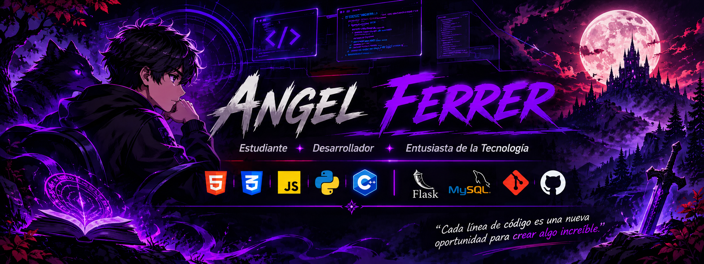

  

# 👾 ¡Hola! Soy Angel Ferrer

### 💻 Estudiante | Desarrollador | Entusiasta de la tecnología

¡Bienvenido a mi perfil de GitHub!

Actualmente soy estudiante de la **Facultad Experimental de Ciencias de la Universidad del Zulia (LUZ)**. Me interesa el mundo de la programación, el desarrollo de software y la creación de soluciones tecnológicas.

Me apasiona convertir ideas en proyectos funcionales, experimentar con nuevas herramientas y seguir ampliando mis conocimientos.

También me gusta mantenerme al día con las nuevas tendencias en **Inteligencia Artificial (IA)**. Siempre que tengo la oportunidad, exploro estas tecnologías y las pongo en práctica en mis proyectos para descubrir nuevas formas de desarrollar y resolver problemas.

---

## 🎮 Tecnologías y herramientas

### 💡 Lenguajes de programación

### ⚙️ Herramientas y tecnologías

---

## 🚀 Proyectos destacados

### 🐺 Cuentos de Cacería

Aplicación web para la creación y personalización de personajes de un sistema de rol. Incluye generación de fichas dinámicas, selección de arquetipos, oficios y diferentes características.

🔗 [Ver repositorio](https://github.com/angelferrer200444-oss/Cuento-de-Caceria---Creacion-de-Hoja)

### 📚 Book Wellness

Aplicación web para gestionar y realizar seguimiento de hábitos de lectura. Desarrollada con Python, Flask y MySQL, permite organizar libros y registrar el progreso de lectura.

### 🔮 Más proyectos en camino...

Estos son solo algunos de mis proyectos. Continúo trabajando en nuevas ideas, explorando tecnologías y desarrollando aplicaciones que me permitan seguir creciendo como programador.

---

## 📊 Estadísticas de GitHub

---

## 📫 Contacto

¿Tienes alguna idea, propuesta o proyecto interesante? ¡Me gustaría conocerlo!

- 📧 **Correo:** [angelferrer200@gmail.com](mailto:angelferrer200@gmail.com)
- 🐙 **GitHub:** [@angelferrer200444-oss](https://github.com/angelferrer200444-oss)

---

### 👾 «Cada línea de código es una nueva oportunidad para crear algo increíble».

**Gracias por visitar mi perfil. ¡Nos vemos en el próximo proyecto!** 🚀

